# Impacto del curso Pescar en sus egresados

Este repo junta el análisis de la encuesta de seguimiento que respondieron **24 egresados** del curso entre agosto y noviembre de 2022. La idea fue ver qué pasó después del curso en tres frentes: si consiguieron trabajo, cómo cambió su presencia profesional online y qué cambió a nivel personal.

Incluye todo el proceso: desde el CSV crudo de Google Forms hasta los gráficos, pasando por la limpieza y transformación de los datos.

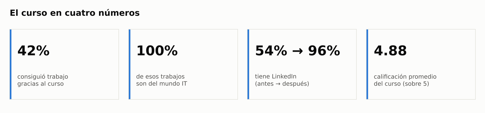

---

## Lo más importante, en corto

| Indicador | Resultado |
|---|---|
| Consiguieron trabajo gracias al curso o a LinkedIn | **42 %** (10 de 24) |
| De esos trabajos, cuántos llegaron por la red de Pescar | **100 %** |
| De esos trabajos, cuántos son del mundo IT | **100 %** |
| Tienen LinkedIn (antes → después) | **54 % → 96 %** |
| Tienen GitHub (antes → después) | **50 % → 88 %** |
| Sienten que cambió su autopercepción | **100 %** |
| Calificación promedio del curso | **4,88 / 5** |

---

## Qué hay en el repo

```
.
├── data/
│   ├── raw/form_respuestas.csv          # export original de Google Forms
│   └── processed/
│       ├── respuestas_limpias.csv       # dataset limpio y anonimizado
│       ├── calidad_datos.md             # reporte de calidad de datos
│       └── metricas.json                # los números que aparecen en este README
├── images/                              # gráficos generados
├── src/
│   ├── etl.py                           # limpieza y transformación
│   └── analisis.py                      # análisis y gráficos
└── requirements.txt
```

## Cómo correrlo

```bash
pip install -r requirements.txt
python src/etl.py        # genera data/processed/
python src/analisis.py   # genera images/ y metricas.json
```

---

## Ingeniería de datos

El CSV que exporta Google Forms no viene listo para analizar. Los encabezados son las preguntas enteras, varias respuestas mezclan dos datos en uno y las preguntas de opción múltiple llegan como un solo texto separado por comas. `src/etl.py` se encarga de ordenar todo eso:

1. **Renombra las columnas** a nombres cortos (`"Tenias un Linkedin antes del curso?"` pasa a ser `linkedin_antes`).
2. **Elimina filas vacías.** Google Forms dejó una al final del archivo.
3. **Normaliza los sí/no.** `Sí`, `si` y `Si, pero…` quedan como `True`; todo lo que empieza con `No` queda como `False`; lo vacío queda como dato faltante. Antes de comparar se sacan tildes y mayúsculas.
4. **Separa las respuestas que traían dos datos juntos:**
   - `"Si y cambie de trabajo durante el curso"` → `trabajaba_antes` + `cambio_trabajo_en_curso`
   - `"Si, pero el curso me ayudo a mejorarlo"` → `cv_antes` + `cv_mejorado_en_curso`
   - `"si por recomendacion/posteo … de la red de pescar"` → `consiguio_trabajo` + `trabajo_via_red_pescar`
5. **Abre la pregunta de opción múltiple** sobre cambios personales en 6 columnas de sí/no, más un total (`n_cambios`).
6. **Ordena las categorías** de edad y nivel de inglés para que los gráficos respeten la progresión.
7. **Crea variables nuevas a partir de los links**: si la persona compartió su LinkedIn, su GitHub o el repo del proyecto final.
8. **Anonimiza.** Se sacan nombre, apellido, email y URLs; en el dataset final cada persona es solo un `id`.
9. **Chequea consistencias** y deja todo anotado en [`calidad_datos.md`](data/processed/calidad_datos.md).

### Problemas que aparecieron en los datos

- 2 personas dicen que **no** estudian una carrera, pero después indican qué tipo de carrera estudian.
- 1 persona dice que no consiguió trabajo por el curso, pero marca que "el trabajo es IT" (seguramente habla de su trabajo actual).
- 4 personas no tienen equipo asignado.
- **Los rangos de edad se pisan** (20-22 y 22-24) y no hay opción entre 24 y 28.
- Algunas preguntas solo aplican a una parte de la gente (por ejemplo, "¿fue tu primer trabajo?"), pero el formulario se las muestra a todos. Por eso, en esas respuestas no se distingue el "no" del "no me corresponde".

---

## Análisis

### 1. Quiénes respondieron

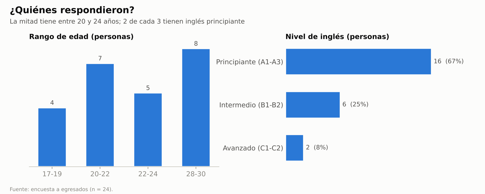

La mitad tiene entre 20 y 24 años, aunque el grupo más grande es el de 28 a 30 (8 personas). En inglés, la mayoría está en nivel principiante: 2 de cada 3.

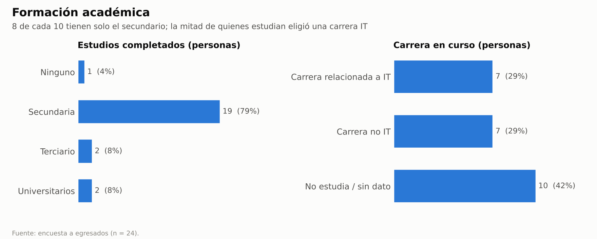

Casi 8 de cada 10 tienen solo el secundario completo. De quienes están estudiando una carrera, la mitad eligió algo relacionado con IT.

### 2. Desde dónde arrancaron

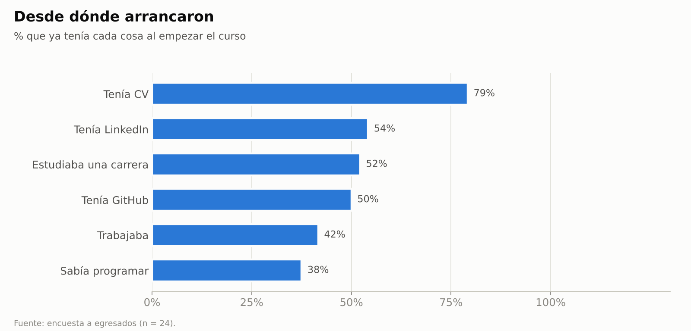

Antes de empezar, la mayoría ya tenía CV (79 %), pero solo la mitad tenía LinkedIn o GitHub. El 42 % ya trabajaba y poco más de un tercio sabía algo de programación. Este gráfico sirve de línea de base para comparar lo que viene después.

### 3. Trabajo

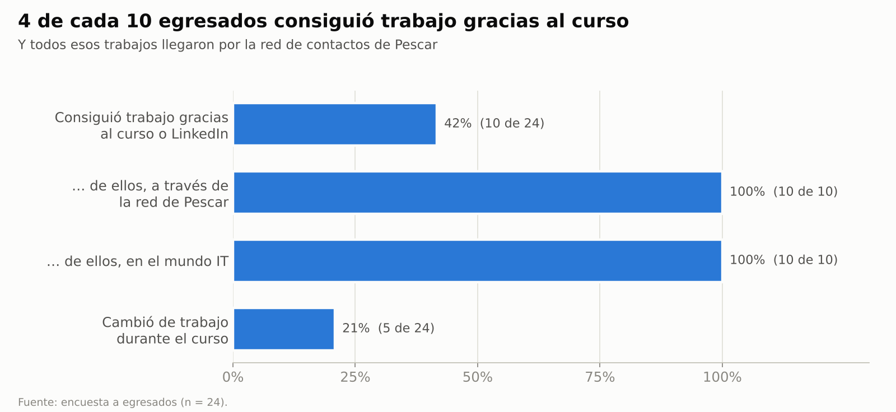

**10 de las 24 personas consiguieron trabajo gracias al curso o a LinkedIn.** Hay dos datos que llaman la atención:

- **Todos esos trabajos llegaron por la red de Pescar**, ya sea por recomendaciones o por búsquedas que se compartieron ahí. Es, por lejos, el canal que más funcionó.
- **Los 10 trabajos son del mundo IT**, que es justamente el objetivo del curso.

Además, 5 personas (21 %) cambiaron de trabajo mientras cursaban.

### 4. Presencia profesional online

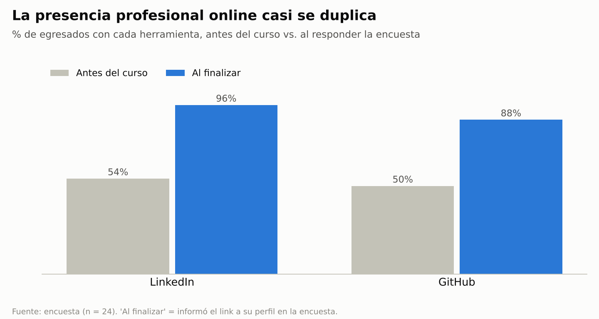

Acá el cambio es bastante claro. Antes del curso, la mitad tenía LinkedIn o GitHub; al momento de la encuesta, **23 de 24 compartieron su LinkedIn y 21 de 24 su GitHub**. Además, de las 19 personas que ya tenían CV, 12 (63 %) dicen que el curso las ayudó a mejorarlo.

### 5. Cambios a nivel personal

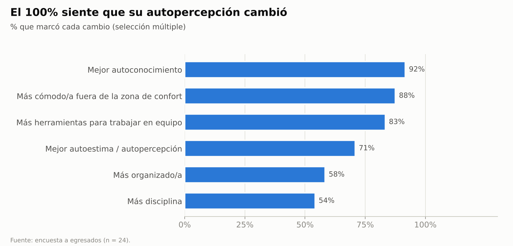

**Las 24 personas sienten que cambió cómo se ven a sí mismas.** Lo que más se repite es el autoconocimiento (92 %), animarse a salir de la zona de confort (88 %) y tener más herramientas para trabajar en equipo (83 %).

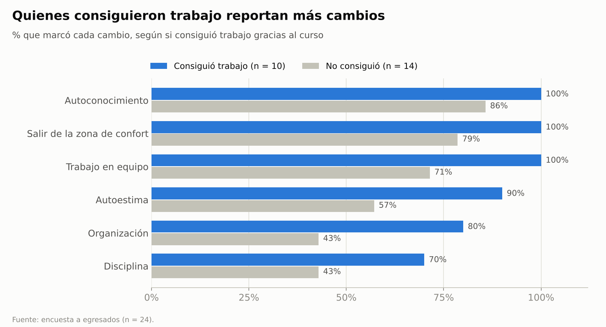

Cuando se separa a quienes consiguieron trabajo del resto, la diferencia es notable. En promedio, quienes consiguieron trabajo marcaron **5,4 de los 6 cambios**, contra **3,8** de quienes no consiguieron. Las brechas más grandes están en organización (80 % contra 43 %) y autoestima (90 % contra 57 %). Con estos datos no se puede saber qué vino primero, pero el desarrollo personal y la inserción laboral parecen ir de la mano.

### 6. Qué perfil consiguió más trabajo

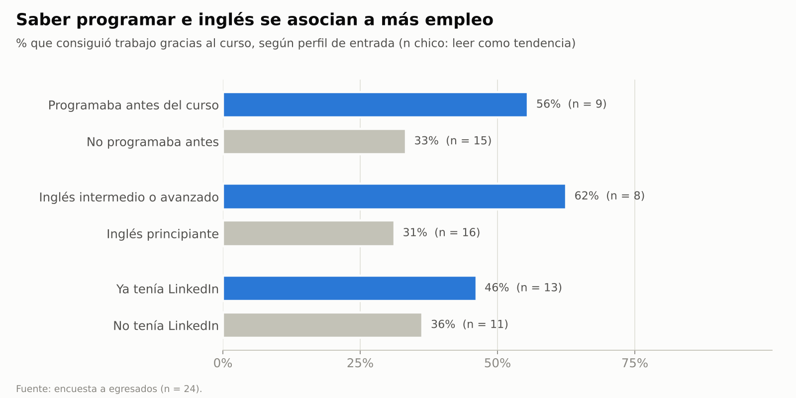

- De quienes **ya programaban** antes del curso, el 56 % consiguió trabajo; de quienes no, el 33 %.
- Con **inglés intermedio o avanzado**, el 62 %; con inglés principiante, el 31 %.
- Tener LinkedIn de antes hace menos diferencia: 46 % contra 36 %.

> **Ojo con estos números:** los grupos son de entre 8 y 16 personas, así que estas diferencias hay que leerlas como tendencias y no como resultados con peso estadístico.

### 7. Emprendimiento e idiomas

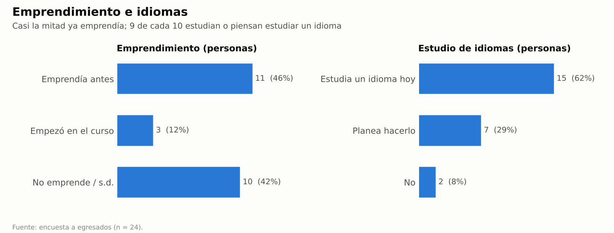

Casi la mitad ya tenía un emprendimiento antes del curso y 3 personas arrancaron uno mientras cursaban. De quienes respondieron la pregunta, 4 dicen que el curso los impulsó a emprender, ya sea por motivación, herramientas o contactos.

Con los idiomas hay mucho interés: el 62 % está estudiando uno y otro 29 % piensa hacerlo.

### 8. Cómo calificaron el curso

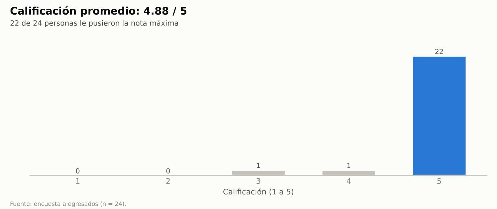

22 de 24 personas le pusieron un 5. El promedio queda en **4,88 sobre 5**.

---

## Conclusiones

1. **El curso logra lo que se propone en cuanto a trabajo.** El 42 % consiguió empleo y todos esos empleos son del sector IT.
2. **La red de Pescar es lo que más pesa.** El 100 % de los trabajos llegó a través de ella. Más que el contenido técnico por sí solo, lo que abre puertas son los contactos y las recomendaciones.
3. **La presencia profesional online mejora mucho.** LinkedIn pasa del 54 % al 96 % y GitHub del 50 % al 88 %.
4. **El impacto personal llega a todos.** Todos reportan algún cambio, y quienes consiguieron trabajo reportan bastantes más.
5. **Llegar con más base parece ayudar.** Quienes ya tenían inglés intermedio o sabían programar consiguieron trabajo con casi el doble de frecuencia. Hay mucho interés en estudiar idiomas, así que es un tema que vale la pena seguir de cerca.

## Oportunidades de mejora para la próxima encuesta

- **Rangos de edad:** que no se pisen y que no queden huecos (por ejemplo: 17-19, 20-22, 23-25, 26-28, 29-31).
- **Preguntas que solo aplican a algunos:** mostrarlas solo a quienes corresponde (con la opción de ir a otra sección según la respuesta), así se distingue un "no" de un "no aplica".
- **Situación laboral actual:** sumar una pregunta aparte del tipo "¿tenés trabajo hoy?", para no mezclarla con "¿lo conseguiste gracias al curso?".
- **Más respuestas:** con 24 personas, cualquier comparación entre subgrupos queda débil. Sumar más cohortes permitiría sacar conclusiones más firmes.
- **Seguimiento en el tiempo:** repetir la encuesta a los 6 y 12 meses para ver si los egresados se mantienen en sus trabajos y cómo evolucionan.
- **Campos obligatorios:** marcar como obligatorias las preguntas clave (equipo, carrera) para no perder datos.

---

## Privacidad

El dataset procesado está anonimizado. El CSV crudo en `data/raw/` todavía tiene nombres de pila; si el repo va a ser público, conviene no subirlo. En `.gitignore` hay una línea comentada para excluirlo.

## Herramientas

Python, pandas y matplotlib.
